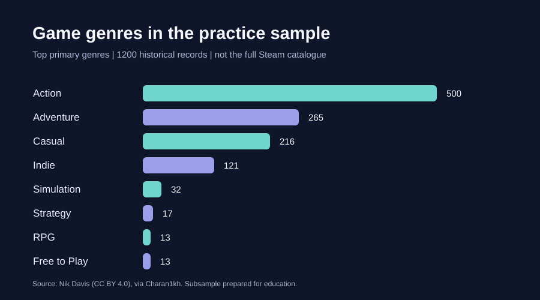

# Steam Game Data Analysis 🎮

**A beginner-friendly statistics portfolio project using R, ggplot2, and SQLite SQL.**

> **Status: Starter draft / work in progress.** The dataset and a preview chart are provided, but the R scripts have **not yet been executed in an R environment**. Findings should be verified before using this project in a résumé.

## Research questions

1. How does the recorded game price relate to the share of positive ratings?
2. Which genres are most common in the provided practice sample?
3. How do free and paid games differ in their positive rating shares?

These are **exploratory associations**, not causal questions. Number of reviews is not the number of players, and the proportion of positive ratings is not an official Steam review score.

## Preview



The preview was calculated from the included sample. It is **not** a distribution of all Steam titles.

## Dataset and attribution

- **Original dataset:** Nik Davis, [Steam Store Games (Clean dataset)](https://www.kaggle.com/datasets/nikdavis/steam-store-games), collected around **May 2019**, licensed **CC BY 4.0**.
- **CSV used for sample extraction:** [Charan1kh/Steam_store_analysis](https://github.com/Charan1kh/Steam_store_analysis), a reformatted derivative crediting Nik Davis.
- **Transformation here:** selected 1200 records deterministically from a restricted practice pool; retained only app ID, title, up to three genre fields, positive/negative review counts, and recorded price. See [DATA_SOURCE.md](DATA_SOURCE.md).
- **Scope:** The included CSV is a historical educational subset, not live 2026 Steam data and not a statistically representative random sample of the entire store.
- **Price:** Source lists historical prices; **currency/region not independently verified**. Use only relative comparisons, not current prices.

The source data is reused with attribution under [CC BY 4.0](https://creativecommons.org/licenses/by/4.0/). The title/genre exclusions and subsampling mean the sample is **not appropriate for generalizing to the Steam market**.

## Project structure

```text
steam-game-analysis/
├── README.md
├── DATA_SOURCE.md
├── data/
│   └── steam_sample.csv
├── figures/
│   └── genre_counts.svg
├── scripts/
│   ├── 01_analysis.R
│   ├── 02_import_sqlite.R
│   └── 03_queries.sql
└── .gitignore
```

## Run the analysis (R / RStudio)

1. Download this folder and open it as your working directory in RStudio.
2. In the R console, install packages **once**:

```r
install.packages(c("readr", "dplyr", "ggplot2", "DBI", "RSQLite"))
```

3. Run from the **steam-game-analysis** folder:

```r
source("scripts/01_analysis.R")
```

4. Open the generated files in `outputs/`: cleaned data, summary tables, a descriptive note, and three PNG plots.

**Optional SQL practice:** run `source("scripts/02_import_sqlite.R")`, then open the generated `outputs/steam_games.sqlite` in a SQLite viewer and execute `scripts/03_queries.sql`.

If R cannot find `data/steam_sample.csv`, your working directory is incorrect. In RStudio, use **Session → Set Working Directory → Choose Directory**, then select this folder.

## What the R analysis does

1. Reads the CSV and checks the expected columns.
2. Converts numeric columns, checks invalid values, and creates `total_reviews`, `positive_share`, and `primary_genre`.
3. Draws a genre count chart, price-versus-rating scatterplot, and free/paid rating share comparison.
4. Saves summary CSV files and notes explaining the sample limitations.

## Interpretation checklist (to finish yourself)

- [ ] Run the R script successfully and check the saved figures.
- [ ] Describe **what the plots actually show** using numbers from the outputs.
- [ ] Explain why correlation does not imply causation.
- [ ] Discuss missing data, historical prices, review-count bias, and sampling limitations.
- [ ] Change **at least one** plot or research question and explain your reasoning.
- [ ] (Optional) Analyse the [original full dataset](https://www.kaggle.com/datasets/nikdavis/steam-store-games) after reviewing its license and file format.

## Skills demonstrated (once verified)

R data cleaning · exploratory analysis · ggplot2 visualisation · SQLite queries · GitHub documentation

**Not a finished résumé result:** Use this as a starting point, then run it, interpret results independently, and explain your contributions before listing it in applications.
